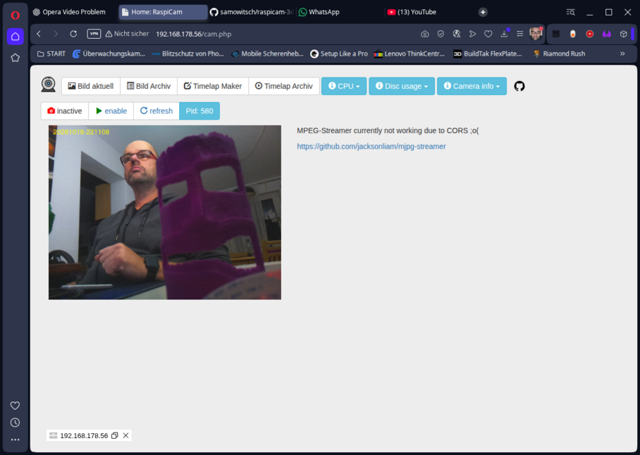
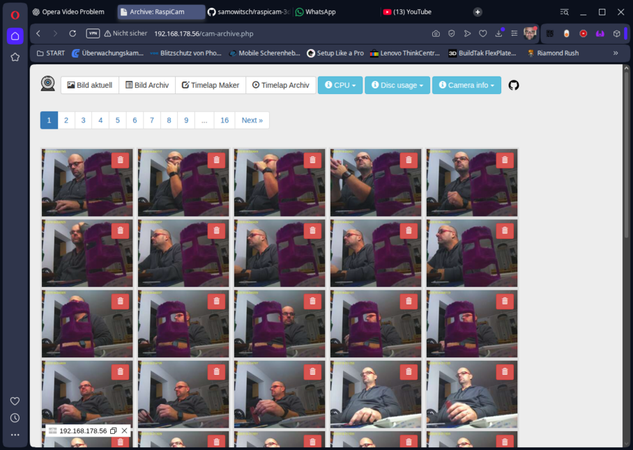
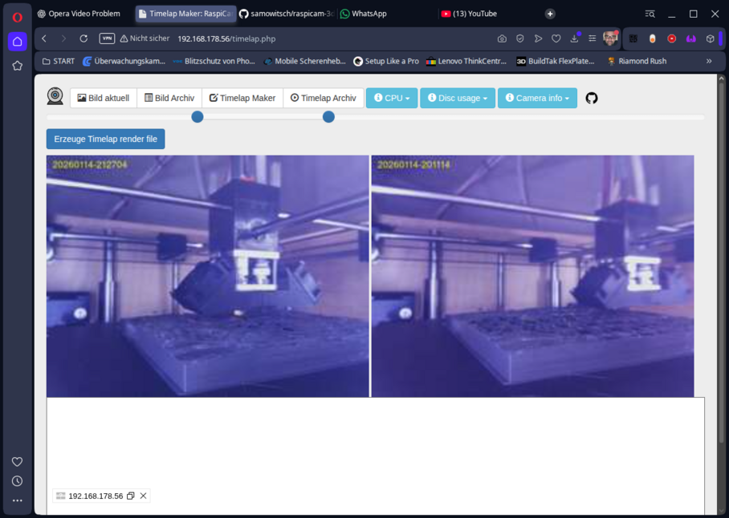
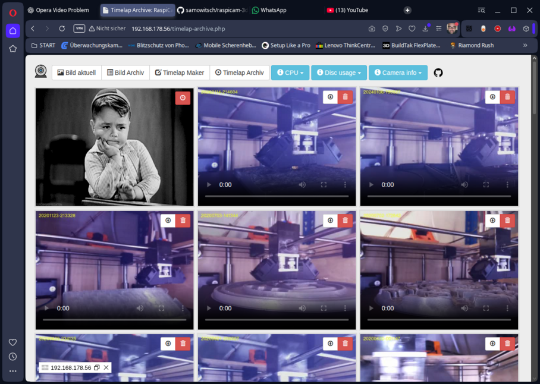

<!-- TOC -->

- [Readme](#readme)
  - [Description](#description)
  - [Installation](#installation)
    - [Install raspbian lite image (Trixie at time of writing)](#install-raspbian-lite-image-trixie-at-time-of-writing)
    - [Install additional packages](#install-additional-packages)
    - [Apache2 PHP stuff](#apache2-php-stuff)
    - [Install composer](#install-composer)
    - [Git clone this repo](#git-clone-this-repo)
  - [Usage](#usage)
  - [Misc notes](#misc-notes)
    - [sudoers file for php shell\_exec](#sudoers-file-for-php-shell_exec)
    - [Crontab for scripts](#crontab-for-scripts)
    - [Show running script file](#show-running-script-file)
    - [Kill running script file](#kill-running-script-file)
    - [Coding notes](#coding-notes)
  - [Screenshots](#screenshots)
    - [Home/Dashboard](#homedashboard)
    - [Image Archive](#image-archive)
    - [Timelap Maker](#timelap-maker)
    - [Timelap Archive](#timelap-archive)
  - [Known bugs](#known-bugs)

<!-- /TOC -->

# Readme

## Description

This is my small raspicam project for my DIY UM2 3d printer. It has some basic features like taking sequence of photos with the attached camera and generating a timelap of it. There is no 3d printer control like [OctoPrint](https://octoprint.org). It is only for monitoring.


The camera at the edge corner is handled by a Raspberry with installed MJPG-Streamer (I forgot the link to it. MJPG-Streamer is a little bit outdated but does its job). The other one facing at the print bed is using this repo.

## Installation

Hopefully complete. This readme is mostly for my own forgetfulness. ;o) 

### Install raspbian lite image (Trixie at time of writing)

The best is to use Raspberry Pi Imager for this.

### Install additional packages

> sudo apt update  
> sudo apt upgrade  
> sudo apt install apache2 -y  
> sudo apt install php libapache2-mod-php php-mbstring php-curl  
> sudo apt install git  
> sudo apt install ffmpeg  
> sudo apt install imagemagick  
> sudo apt install bc

### Apache2 PHP stuff

To access in PHP ```shell_exec('rpicam-still --list-cameras')``` rpicam-still some group permissions has to be set:

> sudo usermod -aG video www-data  
> sudo systemctl restart apache2

### Install composer

See https://getcomposer.org/download/ how to install composer. 

### Git clone this repo

Clone this repo into ```/var/www/html``` Apache2 folder and fiddle around with permissions of files.

## Usage

Should be self-explanatory. Start/Stop image recording at Home/Dashboard. Make timelaps in Timelap Maker. Look at images/videos in the archives.

## Misc notes

### sudoers file for php shell_exec

```bash
sudo visudo
```

and add at appropriate position 

```
www-data ALL=NOPASSWD: ALL
```

### Crontab for scripts

Crontab scripts are running every minute:

```bash
#* * * * * /var/www/html/scripts/cam.sh
@reboot /var/www/html/scripts/cam.sh &
* * * * * /var/www/html/scripts/timelap.sh
```
see [https://crontab.guru](https://crontab.guru) for more crontab syntax

### Show running script file

Show running script file: ```ps aux | grep "cam.sh"``` or ```ps aux | grep "timelap.sh"```

### Kill running script file

Kill running process: e.g. ```kill 1478``` the 1478 you get from ```ps aux``` from above

### Coding notes

```bash
vendor/bin/php-cs-fixer -vvv fix --dry-run
vendor/bin/php-cs-fixer fix
```

## Screenshots

### Home/Dashboard



Simple dashboard to view the current image. The right side iframe with MJPEG-Streamer of second camery is currently disabled. Start/stop image recording. Every 30 secs a image will be recorded.

### Image Archive



The archive of the recorded images.

### Timelap Maker



Select start and end image of image archive to render a mp4 video with ffmpeg. A duration of each image can be selected (screenshot is outdated).

### Timelap Archive



Overview of the ffmpeg rendered timelaps. The little kid is waiting for current video rendering. When rendering is done the kid disappears.

## Known bugs

* MJPG-Stream iframe on Home/Dashboard is currently disabled due to CORS